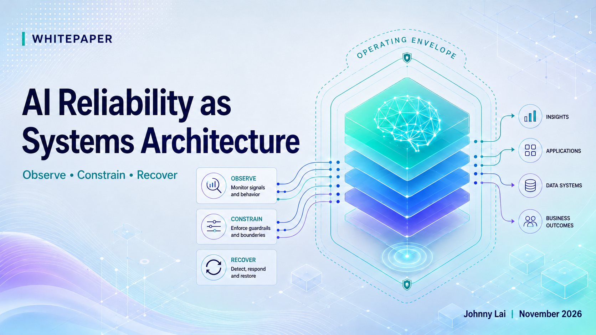

# AI Reliability as Systems Architecture

### Designing Operating Conditions, Controls, and Evidence for AI with Delegated Authority

## Abstract

AI reliability cannot be evaluated only at the model level. As AI participates in workflows, influences decisions, uses enterprise tools, and executes actions, reliability depends on the complete AI-enabled system, including context, authority, workflow state, controls, human oversight, execution, and recovery.

This whitepaper introduces an **AI Reliability Architecture Framework** for translating application characteristics and intended operating conditions into Reliability Requirements, Reliability Functions, Architectural Controls, Reliability Evidence, and Reliability Acceptance Criteria.

## Key Takeaways

- **AI reliability is a system property**, not primarily a model property.
- **Application Characteristics** and the **Intended Operating Envelope** define the reliability problem for a specific AI application.
- The **Reliability Profile** shows where reliability demands concentrate and helps prioritize architectural attention.
- Six **Reliability Domains** identify where reliability concerns require analysis: Input & Context, Model & Reasoning, Workflow & Coordination, Action & Execution, Infrastructure & Operational, and Human-AI Interaction.
- **Observe, Constrain, and Recover** provide the supervisory Reliability Functions used to protect required operating conditions.
- **Architectural Controls** implement those functions and enforce Reliability Requirements.
- **Reliability Evidence** and **Reliability Acceptance Criteria** support deployment and continued-operation decisions.
- **Reliability Maintenance** keeps the framework aligned as models, data, policies, workflows, permissions, dependencies, and operating conditions change.

## Read the Whitepaper

- [Read the Markdown edition](whitepaper.md)
- [View the complete PDF edition](pdf/ai-reliability-as-systems-architecture.pdf)

## Citation

Use GitHub's **Cite this repository** feature or see [`CITATION.cff`](CITATION.cff) for the recommended citation.

## License

This publication is licensed under the terms described in [`LICENSE.md`](LICENSE.md).

## About the Author

Johnny Lai is a product and platform leader whose work spans enterprise software, cloud infrastructure, communications systems, digital commerce, and AI-enabled platforms and workflows. He also serves as an Adjunct Lecturer in Computer Science at Hunter College.
