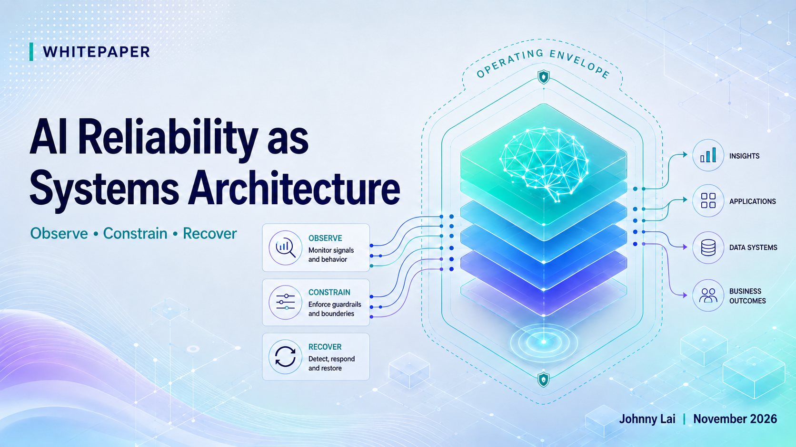
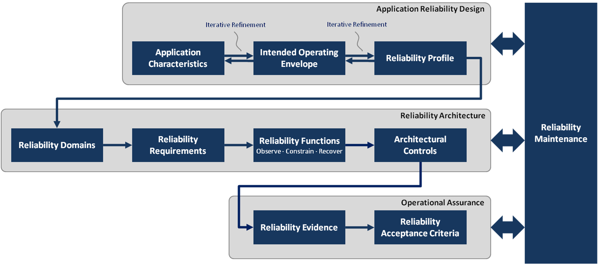
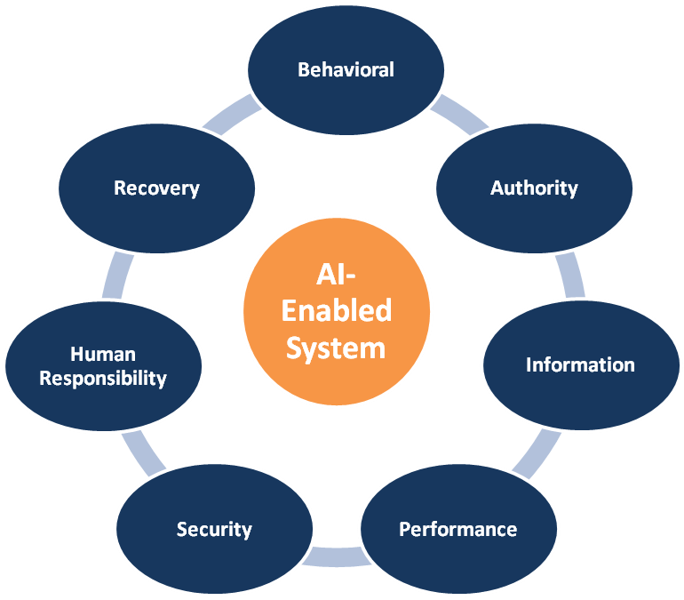
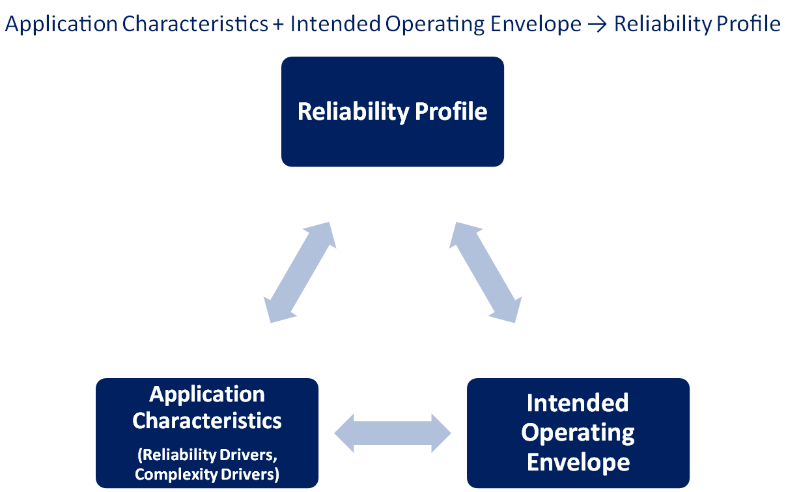
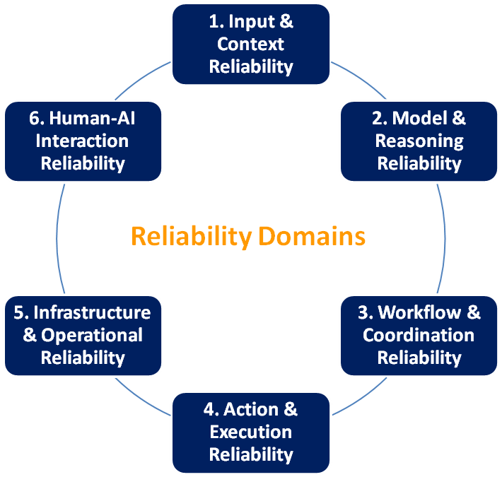
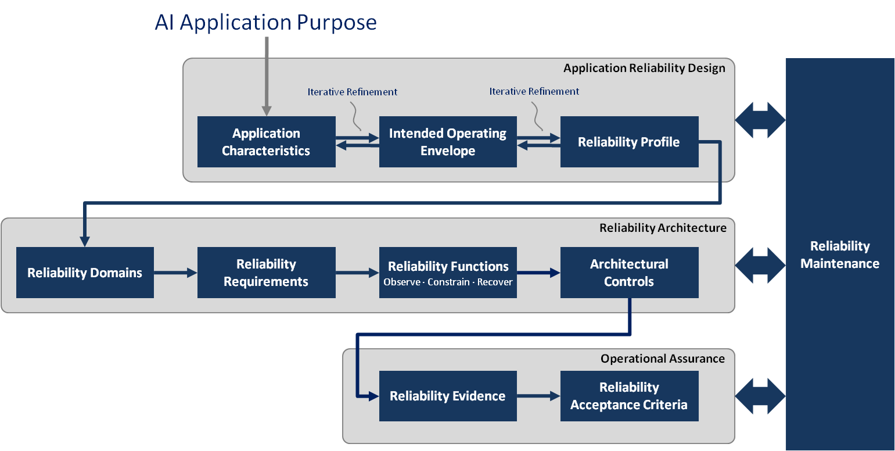

# AI Reliability as Systems Architecture

**Designing Operating Conditions, Controls, and Evidence for AI with Delegated Authority**

  

Johnny Lai

Version 1.0
November 2026

**AI Reliability as Systems Architecture**

Version 1.0

**Author:** Johnny Lai

**Published:** November 2026

**Last updated:** November 2026

Copyright © 2026 Johnny Lai.

This work is licensed under the Creative Commons Attribution-NonCommercial-NoDerivatives 4.0 International License.

# 1. Executive Summary

As artificial intelligence (AI) moves from generating information to participating in workflows and executing actions, reliability can no longer be evaluated primarily at the AI model level. A model error may be contained by validation, authorization, workflow controls, or human intervention. Conversely, a correct model output can still produce an unacceptable result because of outdated context, excessive authority, workflow failure, weak oversight, or execution error.

This whitepaper presents an AI Reliability Architecture Framework composed of nine core components: Application Characteristics, Intended Operating Envelope, Reliability Profile, Reliability Domains, Reliability Requirements, Reliability Functions, Architectural Controls, Reliability Evidence, and Reliability Acceptance Criteria.

Reliability Maintenance, acting as a lifecycle process, keeps the framework aligned as the AI application and its operating environment change. Security is treated as a system-wide architectural concern. The central argument is that AI reliability is a property of the complete AI-enabled system, not primarily of the AI model.

# 2. Introduction

Much discussion of AI reliability begins with model accuracy, hallucination rates, instruction adherence, and benchmarks. These measures matter, but they become incomplete as AI participates in real work.

A document-summarization assistant presents a different reliability problem from a system that routes cases, modifies records, invokes enterprise tools, or initiates transactions. The AI model may be the same; but information access, delegated authority, workflow participation, human oversight, and consequences are not.

Reliability cannot be understood primarily as an AI model property. It emerges from the complete AI-enabled system and the interactions among its components (Tabassi, 2023; Leveson & Thomas, 2018). AI reliability is the ability of the complete AI-enabled system to operate acceptably within its Intended Operating Envelope despite uncertainty, changing conditions, and component imperfections.

This paper uses reliability in a systems-architecture sense. It does not replace quantitative methods such as failure-rate, availability, or lifetime analysis where those methods apply.

An AI model error may be contained by an independent control. A correct output can still lead to failure if workflow routing, information use, approval, or execution is wrong. The engineering objective is not flawless components, but an architecture in which component imperfections do not automatically become unacceptable outcomes.

As AI gains persistent context, tool access, workflow participation, decision influence, and delegated authority, two questions become central: What must remain true for this system to operate acceptably, and what prevents it from operating outside those conditions?

Engineered systems have long relied on containment, independent controls, monitoring, escalation, and recovery. AI-enabled systems need the same discipline while accounting for probabilistic behavior and changing context (Bloomfield & Rushby, 2024).

# 3. AI Reliability Architecture Framework

The **AI Reliability Architecture Framework** translates an AI application’s characteristics and intended operating conditions into reliability requirements, controls, evidence, and assurance decisions.

The framework consists of nine core components:

* Application Characteristics
* Intended Operating Envelope
* Reliability Profile
* Reliability Domains
* Reliability Requirements
* Reliability Functions
* Architectural Controls
* Reliability Evidence
* Reliability Acceptance Criteria

Reliability Maintenance operates across the lifecycle and is not a separate component.

For presentation, the nine components are grouped into Application Reliability Design, Reliability Architecture, and Operational Assurance. Reliability Maintenance spans all three.

The framework moves from understanding the reliability problem to defining what must remain true, implementing supervisory responses, and evaluating evidence for assurance.

  

  <b>Figure 1: AI Reliability Architecture Framework.</b>

## Interworking of Framework Components

Some relationships are iterative, while others are more directional.

* **Application Characteristics** describe properties that create or amplify reliability demands.
* **Intended Operating Envelope** defines acceptable operating conditions.

Together they influence the **Reliability Profile**, which shows where demands concentrate and why. These three components are refined iteratively as understanding of the application and its operating conditions develops.

From this context of application reliability design, the framework subsequently becomes more directional:

* **Reliability Domains** identify where concerns require attention.
* **Reliability Requirements** specify what must remain true.
* **Reliability Functions** provide supervisory capabilities to Observe, Constrain, and Recover.
* **Architectural Controls** implement those functions and enforce the requirements.
* **Reliability Evidence** supports assurance.
* **Reliability Acceptance Criteria** define when that evidence is sufficient for deployment or continued operation.
* **Reliability Maintenance** uses evidence and observed change to trigger reassessment.

**Use of Example:**

The following sections use a recurring customer refund scenario. The AI-enabled system interprets requests, retrieves customer and transaction information, recommends decisions, and may execute qualifying refunds within defined authority limits. Larger or exceptional refunds require authorized human approval.

# 4. Application Characteristics

Application Characteristics describe properties of the AI application and operating context that create or amplify reliability demands, even when similar AI models are used.

The framework examines two groups of drivers:

* **Reliability Drivers:** authority, influence, autonomy, consequence, and reversibility.
* **Complexity Drivers:** coupling, persistence, coordination, human participation, external exposure, and rate of change.

Their significance also depends on the Intended Operating Envelope.

## Reliability Drivers

| Characteristic | Why It Matters |
| ----- | ----- |
| Delegated Authority | How much the AI-enabled system may decide or execute on behalf of a person or organization. Greater authority creates a more direct path from AI behavior to business consequence. |
| Decision Influence | How strongly AI output shapes consequential human decisions, even when the AI has no direct execution authority. |
| Autonomy | How independently the AI-enabled system can initiate, plan, and complete work between human checkpoints. |
| Consequence of Error | How serious an unacceptable decision or action could be. |
| Reversibility | How easily a wrong action can be corrected or undone. Actions that are difficult to reverse require greater care before execution. |

## Complexity Drivers

| Characteristic | Reliability Implication |
| ----- | ----- |
| System Coupling | More connected systems create more paths for failure propagation and unintended side effects. |
| State Persistence | Memory and persistent state can become outdated, corrupted, or incorrectly linked to the wrong person or situation. Retrieved knowledge, cached context, and prior assumptions may also lose validity as the environment changes, even when the system itself has not been explicitly modified. |
| Coordination Complexity | More humans, AI agents, tools, and workflows increase the likelihood of failures at interaction boundaries. |
| Human Participation | Human review can reduce risk but may also fail through insufficient information, automation bias, weak authority, or lack of time. |
| External Exposure | Public or third-party inputs increase adversarial, security, and unpredictable interaction risks. |
| Rate of Change | Frequent changes to AI models, data, policies, permissions, tools, and workflows increase the need for ongoing revalidation. |

**Example: Customer Refund Scenario**

* Delegated Authority: Can execute qualifying refunds.
* Decision Influence: Recommendations influence human reviewers.
* Autonomy: Can process qualifying cases without continuous supervision.
* Consequence of Error: Incorrect refunds can create financial and customer impact.
* Reversibility: Some transactions can be reversed, but not without cost.
* System Coupling: Connects to customer, policy, workflow, and payment systems.
* State Persistence: Refund and approval states persist across the workflow.
* Coordination Complexity: Coordinates AI behavior, human review, policy checks, customer records, and payment services.
* Human Participation: Larger or exceptional refunds require human review.
* External Exposure: Customer-provided input enters the system.
* Rate of Change: Policies, models, and related system configurations may change.

Together, these characteristics show why reliability extends beyond whether the AI model interprets a refund request correctly.

# 5. Intended Operating Envelope

The **Intended Operating Envelope** defines the conditions within which the AI-enabled system is designed and authorized to operate acceptably across seven dimensions: Behavioral, Authority, Information, Performance, Security, Human Responsibility, and Recovery. It is refined iteratively with Application Characteristics and the Reliability Profile, not fixed before reliability analysis.

Without explicit operating conditions, reliability is too vague to guide architecture. AI applications with different authority, consequence, reversibility, exposure, and dependencies should not be judged by identical expectations.

The Intended Operating Envelope is defined across seven dimensions. Together, they specify the conditions under which operation is considered acceptable.

| Dimension | Core Question |
| ----- | ----- |
| Behavioral | What behavior is acceptable, and what behavior is prohibited? |
| Authority | What may the AI-enabled system recommend, decide, or execute? |
| Information | What data may it access and use, and for what purpose? |
| Performance | What quality, latency, consistency, and uncertainty levels are acceptable? |
| Security | Which identities, access permissions, data, systems, and trust relationships must be protected from unauthorized access or action? |
| Human Responsibility | Where must human judgment, approval, supervision, or intervention occur? |
| Recovery | What should happen when expected conditions no longer hold? |

  

  <b>Figure 2: Intended Operating Envelope and Its Seven Dimensions.</b>

The seven dimensions form a coherent operating design. Authority affects information access, human responsibility affects execution, and recovery constraints can limit autonomy. A change in one dimension may create new Reliability Requirements elsewhere. Reliability Requirements specify what must remain true within the envelope; the architecture determines how those conditions are enforced.

AI model benchmarks alone cannot establish acceptable operation. A factually correct response can still violate the envelope through unauthorized information use, excess authority, bypassed review, or unsafe execution (Tabassi, 2023).

Operating within the Intended Operating Envelope does not prove that the envelope itself is correct. Its assumptions, policies, and operating conditions must also be validated as circumstances change. The envelope is a design variable. If authority or autonomy is difficult to control, the organization can strengthen controls or narrow the conditions under which the system is permitted to operate.

**Example: Customer Refund Scenario**

* Process refunds only for authenticated customers (Behavioral, Security)
* Use specified customer and transaction records (Information)
* Autonomously execute refunds up to $100 (Authority)
* Require authorized human approval above $100 (Human Responsibility)
* Meet defined quality and response expectations (Performance)
* Stop or escalate when identity, policy, approval, or transaction conditions cannot be verified (Recovery)

Together, these conditions make acceptable operation explicit across the seven dimensions of the Intended Operating Envelope.

# 6. Reliability Profile

The **Reliability Profile** describes where reliability demands concentrate for a particular AI application and what drives them. It is not a score or checklist result. It synthesizes Application Characteristics and the Intended Operating Envelope to show how the application’s attributes, operating conditions, and permitted behavior affect its reliability needs.

Two AI applications may require equal attention for different reasons. One may be able to execute consequential transactions, while another may depend heavily on persistent context and human participation in shared decisions.

The Reliability Profile helps determine which Reliability Domains require the most attention and where stronger reliability measures may be needed.

**Example: Customer Refund Scenario**

In the customer refund scenario, the Reliability Profile would show where reliability demands are concentrated. These demands arise from Application Characteristics such as transaction authority, financial consequence, workflow coordination, reversibility, dependence on current customer and policy information, and human participation.

The profile would also reflect the Intended Operating Envelope, including the conditions governing refund execution, the requirement for human approval above defined transaction limits, and the circumstances under which the system must stop or escalate rather than proceed.

Within that profile, the highest-priority concerns would include unauthorized refunds, incorrect workflow state, missing or invalid approval, and duplicate or failed payment actions. Minor wording differences in the system’s response may be less significant when the underlying decision, authorization, and execution remain correct.

  

  <b>Figure 3: Reliability Profile, Application Characteristics, and Intended Operating Envelope.</b>

AI model capability does not imply permission to act. The surrounding AI-enabled system determines which model capabilities may be used operationally and should grant only the authority necessary for the intended objective.

Application Characteristics, the Intended Operating Envelope, and the Reliability Profile should be refined iteratively; a profile with greater reliability demands may justify narrower authority or stronger controls.

An AI-enabled system’s delegated authority and decision influence are distinct. An advisory system may strongly affect a human decision without execution permission, while an agentic system may have narrow authority over reversible actions.

A useful question alongside “How autonomous is the AI?” is “Where does an error go next?” Errors that are visible and reversible can justify lighter controls than errors that propagate across services or persistent state (Leveson & Thomas, 2018).

# 7. Six Reliability Domains

The six **Reliability Domains** are analytical lenses for identifying where reliability concerns require attention. Their importance depends on the Reliability Profile and Intended Operating Envelope. The domains do not provide a complete explanation of how failures occur. Failures may span multiple domains or result from shared causes that affect several areas at the same time.

Security is a system-wide concern, while governance and policy are organizational sources of requirements and constraints. Threat modeling, hazard analysis, or fault analysis may be needed in addition to the Reliability Domains.

  

  <b>Figure 4: Reliability Domains</b>

## 7.1 Domain 1: Input & Context Reliability

**Input & Context Reliability** asks whether information is appropriate, authorized, sufficiently complete, and current. Failures include outdated, incomplete, manipulated, incorrectly associated, or unauthorized context. Controls include validation, provenance, freshness checks, filtering, access control, and memory isolation.

## 7.2 Domain 2: Model & Reasoning Reliability

**Model & Reasoning Reliability** concerns whether AI model-produced interpretations, recommendations, or decisions are dependable enough for the intended use. Evaluation, trusted grounding, output validation, model selection, and deterministic checks can reduce risk, but cannot carry the full burden of system reliability.

## 7.3 Domain 3: Workflow & Coordination Reliability

**Workflow & Coordination Reliability** asks whether AI, software, humans, and workflow mechanisms coordinate correctly across routing, state transitions, ordering, and handoffs.

## 7.4 Domain 4: Action & Execution Reliability

**Action & Execution Reliability** asks whether actions are permitted, correctly targeted, properly authorized, and correctly executed. Consequential execution should be validated independently of the AI model (OWASP Foundation, n.d.).

## 7.5 Domain 5: Infrastructure & Operational Reliability

**Infrastructure & Operational Reliability** concerns dependable infrastructure and appropriate behavior when dependencies fail, including degraded or fail-closed operation where required (Tabassi, 2023).

## 7.6 Domain 6: Human-AI Interaction Reliability

**Human-AI Interaction Reliability** asks whether identity, authority, information, timing, and responsibility support effective human participation. Oversight must be engineered as a control, not treated as a checkbox (Sele & Chugunova, 2024).

The Reliability Domains deliberately overlap, and a single underlying cause may affect several at once.

**Example: Customer Refund Scenario**

An outdated customer record (Domain 1) can contribute to a flawed recommendation (Domain 2), wrong workflow route (Domain 3), inappropriate action (Domain 4), and weak approval (Domain 6). A payment-service outage introduces infrastructure and operational reliability concerns (Domain 5).

The goal is to identify conditions that must remain true and translate them into Reliability Requirements. Root causes may lie in retrieval, workflow design, permissions, human review, execution, or shared dependencies.

Interacting AI systems add further complexity because state, authority, and recovery actions can cross governance boundaries. This paper focuses on the reliability architecture of an individual AI-enabled system.

# 8. Reliability Requirements, Reliability Functions, and Architectural Controls

## Reliability Requirements

**Reliability Requirements** specify the conditions that must remain true for acceptable operation within the Intended Operating Envelope. They translate broad concerns identified through the Reliability Domains into operational conditions the system must preserve.

A requirement may span several Reliability Domains and depend on multiple Reliability Functions and Architectural Controls.

**Example: Customer Refund Scenario**

Action & Execution Reliability highlights the risk that the AI could execute a refund beyond its delegated authority, while Human-AI Interaction Reliability highlights the need for valid human authorization when that authority limit is reached. The business policy “Refunds above $100 require human approval” translates into the Reliability Requirement: “The AI-enabled system must prevent autonomous execution of refunds greater than $100 unless valid approval from an appropriately authorized human has been recorded.” A related requirement might state that a refund must not be executed unless the customer identity, qualifying transaction, refund amount, and applicable policy have been validated.

A Reliability Requirement expresses what condition must hold, not the mechanism used to enforce it. This keeps the requirement independent of a particular implementation and allows several controls to work together to satisfy it.

## Reliability Functions: Observe, Constrain, Recover

**Reliability Functions** describe the supervisory capabilities the architecture needs to keep the AI-enabled system within its Reliability Requirements. The framework defines three functions: Observe, Constrain, and Recover.

These functions supervise the application’s normal business operations rather than performing the business task themselves. In the customer refund scenario, interpreting a request, retrieving account information, recommending a decision, routing a case for approval, and executing a refund are business operations. Reliability Functions supervise those operations by determining what is happening, limiting activity when required conditions are not satisfied, and responding when failures or unacceptable conditions occur.

* Reliability Domains identify where concerns require attention.
* Reliability Requirements define what conditions must hold.
* Reliability Functions provide the supervisory capabilities needed to protect those conditions.
* Architectural Controls provide the concrete mechanisms that implement those functions and enforce the requirements.

The relationship is not strictly sequential or one-to-one. Observe may operate before, during, and after an action. Constrain may prevent or limit an action before or during execution. Recover responds when an action, component, assumption, or control fails. One Reliability Requirement may depend on several Reliability Functions, while one Reliability Function or Architectural Control may support multiple Reliability Requirements and Reliability Domains.

**Example: Customer Refund Scenario**

Executing a refund is a business operation. Observe captures the refund amount, workflow state, authorization decision, approval event, and execution result. Constrain prevents execution above the delegated authority threshold without valid authorized approval. Recover preserves case state, prevents duplicate execution, and routes the case to intervention, retry, rollback, or another defined recovery path when an approval or payment step fails.

| Function | Question | Representative Controls |
| ----- | ----- | ----- |
| Observe | What is happening, what happened, and is the AI-enabled system still operating as intended? | Monitoring, logs, traces, evaluation, provenance, anomaly detection, workflow-state observation |
| Constrain | What activity must be prevented or restricted? | Validation, policy enforcement, authentication, authorization, minimum authority, workflow constraints, approval gates, tool restrictions, isolation, execution limits |
| Recover | What happens when a component, assumption, or control fails? | Escalation, rollback, fallback, reduced-function operation, failover, circuit breakers, human intervention, restoration of prior state |

Observe, Constrain, and Recover shift the engineering objective away from preventing every model error. The architecture assumes that components can fail and provides mechanisms to detect unacceptable conditions, limit their propagation, and restore or transfer control when necessary. Reliable operation may sometimes mean stopping, operating with reduced functionality, or transferring control instead of continuing.

Observe, Constrain, and Recover should be designed together because each function addresses a different part of reliability, and weaknesses in one can reduce the effectiveness of the others:

* Observation without constraint may provide strong visibility into what happened while still allowing an unacceptable action to occur.
* Constraint without observation can make it difficult to understand why legitimate activity is being blocked or whether the controls are working as intended.
* Recovery without sufficient observation may restore operation without identifying or resolving the underlying failure.

Recovery mechanisms can also fail or introduce new problems. Retries may create duplicate actions, rollback may leave inconsistent state, failover may use outdated context, and escalation may overload human reviewers. Recovery paths should be subject to Reliability Requirements, Architectural Controls, Reliability Evidence, and validation just as other consequential system operations are.

The balance among Observe, Constrain, and Recover should reflect the consequences of failure and how easily actions can be reversed. Difficult-to-reverse actions need stronger safeguards before execution, while lower-consequence and reversible tasks may justify lighter constraints. The architecture should be proportional to the reliability demands of the AI application.

## Architectural Controls

**Architectural Controls** are the concrete mechanisms through which Reliability Functions are implemented and Reliability Requirements are enforced.

Critical operating constraints should be enforced independently where practical. Natural-language instructions may influence AI model behavior, but they should not be the only mechanism preventing a consequential action. Read-only access, for example, is stronger than instructing an AI agent not to modify records. Execution authority should remain unavailable until required conditions have been satisfied (Bloomfield & Rushby, 2024; OWASP Foundation, n.d.).

Separate controls are not necessarily independent controls. Multiple controls may still fail together if they depend on the same faulty data source, policy engine, identity service, infrastructure component, or underlying assumption. Control design should consider both common-mode failures and common-cause failures, not only the number of safeguards present.

Human review can fail in the same way. If the reviewer relies only on an AI-generated summary built from the same incorrect source information that led to the original recommendation, the approval step may add little independent protection.

A preferred sequence of controls is to eliminate unnecessary authority, limit what remains, validate requested actions, and block violations. Least privilege provides a useful analogy, but AI authority is broader than access privilege: legitimate access to a system does not necessarily imply permission to make a decision or execute an action autonomously (Rose et al., 2020; OWASP Foundation, n.d.).

**Example: Customer Refund Scenario**

The requirement that refunds above $100 cannot be executed without authorized human approval may be implemented through a refund-amount validator, authentication and authorization services, workflow approval state, a policy engine, restricted payment-service permissions, and an execution gate before payment. Logging, workflow-state monitoring, and rollback or compensation mechanisms can support observation and recovery. The mapping is:

* Reliability Requirement – refunds above $100 require authorized approval
* Reliability Function – Constrain
* Architectural Controls – authorization check, workflow approval-state verification, restricted payment permissions, and payment execution gate

Architectural Controls should be traceable to the Reliability Requirements being supported and the Reliability Functions being implemented.

# 9. Security and Human Oversight in Reliability Architecture

Human-AI Interaction Reliability is one of the six Reliability Domains. This section looks more closely at two system-wide concerns that affect several Reliability Domains: security and human oversight, particularly where AI systems exercise authority, interact with external systems, or depend on human approval and intervention.

Security and reliability are related but distinct. Reliability asks whether the system can operate acceptably, while security asks whether unauthorized or malicious activity can compromise that operation. A reliability failure may occur without an attacker. A security failure can push the AI-enabled system outside its Intended Operating Envelope through compromised credentials, malicious input, privilege abuse, or manipulation of an AI agent.

This framework treats security as a system-wide architectural concern because adversarial failures can originate in, propagate through, or exploit weaknesses or dependencies across multiple Reliability Domains. Security becomes a source of Reliability Requirements and Architectural Controls rather than a separate Reliability Domain. This treatment does not replace threat modeling, red-team analysis, or other security-specific methods where active adversaries must be considered.

## Zero Trust and Minimum Authority

Zero Trust provides useful principles for identity, access, resources, and execution paths: avoid implicit trust, distinguish authentication from authorization, verify access in context, and apply least privilege. A legitimate human or AI identity should not imply unrestricted authority (Rose et al., 2020).

Zero Trust should not be reduced to “never trust the AI.” Its primary concern is identity and access. Reliability architecture asks a broader question: even when an actor is authenticated and authorized to reach a system, is the proposed action appropriate in the current workflow, within delegated authority, sufficiently supported, and recoverable if it fails?

For example, Zero Trust may determine whether an AI agent can call a payment service. Reliability architecture must also determine whether that payment should occur under the current operating conditions.

The security principle “assume breach” and the reliability principle “design for component imperfection and failure” are related but distinct. Both favor containment so that a compromised identity, bad output, outdated data source, or failed service does not automatically produce an unacceptable outcome.

## Human Oversight Must Be Engineered

Human participation can improve reliability, but the presence of a human does not establish effective control. Reviewers may lack information, expertise, time, authority, or a genuine ability to intervene. Repetitive approvals can also encourage over-reliance on automated recommendations (Sele & Chugunova, 2024).

Human-in-the-loop describes presence, not effectiveness. Meaningful oversight should establish seven conditions:

| Condition | What Must Be Established |
| ----- | ----- |
| Identity | Who is the person? |
| Authorization | Is this person permitted to make this decision or approve this action? |
| Information | Does the person have the context needed for meaningful review? |
| Capability | Does the person have sufficient expertise and cognitive capacity? |
| Time | Can the person review and intervene before the consequence occurs? |
| Agency | Can the person reject, modify, stop, request information, or escalate? |
| Accountability | Can the decision and its basis later be reconstructed? |

Human approval should not replace independent enforcement. The AI-enabled system should still verify the approver’s authority, approval scope, transaction parameters, and applicable policy. Human judgment contributes context and accountability, while the reliability architecture enforces the operating conditions.

Delegated AI authority and organizational responsibility are different. An AI agent may execute a qualifying action, but responsibility for policy, system design, operating constraints, and business outcomes remains with the organization and its human owners.

Cybersecurity and reliability often intersect in practice. A compromised human account can defeat an approval workflow. An overprivileged agent can turn a reasoning error into an execution failure. An unauthorized context source can create both a security breach and a reliability failure. Shared Architectural Controls, such as authorization checks and execution limits, may support both security and reliability.

Human controls must also remain effective under real workload. Queue depth, case complexity, available context, review time, and escalation rights determine whether oversight actually works in practice.

The framework addresses reliability architecture within a broader system that includes both technology and the people and organizations that operate it. Organizational incentives, staffing constraints, governance failures, and management decisions can affect whether controls remain effective, but those organizational dynamics are not modeled comprehensively in this paper.

# 10. Reliability Evidence, Acceptance Criteria, and Maintenance

Reliability work does not stop once controls are in place. Organizations still need evidence that the controls worked as intended, that important outcomes can be traced and reconstructed, and that requirements, controls, and assumptions remain valid as the system changes.

## Reliability Evidence

**Reliability Evidence** is protected information used to observe, reconstruct, validate, audit, and assess whether an AI-enabled system operated within its Intended Operating Envelope.

Evidence does not make the AI-enabled system reliable. It supports assurance about whether Reliability Requirements and Architectural Controls operated as intended and whether consequential outcomes can be reconstructed.

| Evidence Type | What It Helps Answer |
| ----- | ----- |
| Event Evidence | **What happened?** Authentication events, AI model invocations, approvals, policy violations, alerts, transaction events. |
| Execution Evidence | **How did the operation progress?** Workflow traces, state transitions, tool calls, retries, rollbacks, AI agent interactions. |
| Provenance Evidence | **Where did information or behavior originate?** Data sources, AI model versions, policy versions, workflow configuration, memory entries. |
| Control Evidence | **Which constraints actually applied?** Authorization decisions, validation results, approval records, blocked operations. |
| Outcome Evidence | **What ultimately occurred?** Transaction results, account changes, escalation, rollback, final workflow state. |

For consequential decisions, these evidence types support decision provenance by reconstructing the information, actors, model behavior, controls, approvals, and actions that contributed to an outcome. This helps distinguish whether a failure originated in context, model behavior, workflow routing, authorization, human review, execution, or some combination of them.

Critical evidence should not depend solely on AI self-reporting. An AI agent saying it verified authorization is not equivalent to an independent authorization service recording the check. Evidence for important controls should preferably be generated by, or independently verifiable against, the enforcing component (OWASP Foundation, n.d.). Evidence itself also requires security and privacy controls because logs and traces may contain sensitive information. Conventional logs do not automatically establish who performed an action or prove that the record has not been altered. Where that level of assurance is needed, stronger identity verification, integrity protection, trusted timestamps, or cryptographic mechanisms may be appropriate (Rose et al., 2020; OWASP Foundation, n.d.).

Integrity is not the same as correctness. A protected record can still contain incomplete, delayed, selectively collected, or misleading information. Evidence may also be generated by components that share the same failure mode as the system being assessed. For consequential claims, evidence quality, independence, completeness, and uncertainty should be considered as part of assurance.

Evidence should be derived from Reliability Requirements rather than collected indiscriminately. If a high-value transaction requires authorized human approval, the evidence should capture the amount, applicable policy, approver identity and authorization state, approval decision, and execution outcome. This creates traceability from Reliability Requirement → Architectural Control → Reliability Evidence.

**Example: Customer Refund Scenario**

For a $500 refund, Reliability Evidence might include the authenticated customer identity, transaction amount, applicable policy version, model recommendation, workflow-state transitions, reviewer identity and authorization status, approval record, execution-gate decision, and final payment result. Together, these records allow the organization to reconstruct what happened and determine whether the required control path actually operated.

## Reliability Acceptance Criteria

**Reliability Acceptance Criteria** define the conditions under which available Reliability Evidence is considered sufficient to support deployment or continued operation within the Intended Operating Envelope.

The framework does not define a universal reliability score, grade, or threshold. Acceptance depends on the Intended Operating Envelope, Reliability Profile, consequences of failure, applicable Reliability Requirements, and the organization’s tolerance for residual uncertainty and risk. A low-consequence AI assistant should not be held to the same acceptance threshold as a system authorized to execute consequential financial or operational actions.

Setting Reliability Acceptance Criteria sits at the boundary between engineering and governance. Technical teams can define and evaluate supporting evidence, but the acceptable level of residual uncertainty and risk must ultimately be determined by the responsible organizational authority.

Reliability Acceptance Criteria may specify required evidence, quantitative thresholds, test results, operating observations, procedural conditions, or other assurance conditions that must be satisfied before deployment or continued operation is approved.

**Example: Customer Refund Scenario**

For the requirement that refunds above $100 cannot be executed without authorized human approval, Acceptance Criteria might require evidence that the approval control is enforced across defined test cases, that no known execution path bypasses it, and that operational records show qualifying transactions consistently encounter the required authorization and approval checks.

Some Reliability Requirements need statistical or probability-based criteria rather than absolute pass/fail conditions. For example, an AI-enabled case-routing function might require a defined accuracy threshold for sending cases to the correct next process step, task, queue, or responsible person. Higher-consequence case types may require stricter thresholds. The framework does not prescribe universal values. The criteria should reflect the application’s operating context, consequences, Reliability Profile, and organizational risk decisions.

An AI-enabled system may be considered sufficiently reliable for its intended use when available evidence shows that applicable Reliability Requirements are being satisfied within the Intended Operating Envelope, the defined Reliability Acceptance Criteria have been met, and the responsible organizational authority has accepted the remaining uncertainty and residual risk.

An acceptance decision applies to a particular system configuration, Intended Operating Envelope, assumptions, controls, and operating conditions. It is not a universal declaration that the system is perfectly “reliable.” New failures, degraded controls, material changes, or new evidence may invalidate the decision and require reassessment through Reliability Maintenance.

## Reliability Maintenance

**Reliability Maintenance** is a lifecycle process, not another stage in the framework. An AI-enabled system that operates reliably today may not remain reliable as its AI models, data, policies, workflows, tools, permissions, human practices, dependencies, or threats change.

Some AI-enabled systems change continuously rather than through discrete deployment events. Vendor AI model updates, evolving memory, dynamic tool selection, policy changes, and adaptive behavior may alter system behavior without a clear configuration boundary. In these cases, Reliability Maintenance may require continuous or event-driven monitoring and revalidation rather than reassessment only after explicit releases or known material changes.

**Example: Customer Refund Scenario**

If the organization raises the autonomous refund limit from $100 to $500, replaces the payment API, changes the approval process, or introduces a new AI model, the previous reliability analysis may no longer hold. Reliability Maintenance should trigger reassessment of the affected Application Characteristics, Intended Operating Envelope, Reliability Profile, Requirements, Controls, Evidence, and Acceptance Criteria.

Observe → Evaluate → Detect Deviation → Adapt Architecture or Controls → Revalidate

Drift refers to changes over time in the system, its operating environment, or its underlying assumptions that make previously valid controls less effective. These changes may involve policies, permissions, workflow behavior, human practices, dependencies, data, or AI models (Tabassi, 2023). Material changes in capability or authority deserve particular scrutiny. An AI-enabled system that moves from recommending account changes to executing them directly has a different Reliability Profile even if the underlying model is unchanged.

Reliability Evidence makes Maintenance measurable. Changes in override rates, blocked actions, exception patterns, unusual tool use, latency, recovery frequency, or policy violations may indicate changed characteristics, invalid assumptions, or degrading controls. No single metric proves reliability, but selected evidence can reveal movement toward unacceptable operation before a major failure occurs.

# 11. Applying the Framework Across AI Application Categories

The framework applies across three recurring Application Categories: AI Assistant, Workflow AI, and Collaborative AI. They describe participation in work, not maturity, and the categories may overlap.

| Application Category | Primary Relationship | Typical Role | Reliability Emphasis |
| ----- | ----- | ----- | ----- |
| AI Assistant | AI and individual | Drafts, retrieves, analyzes, summarizes, recommends | Context quality, AI model behavior, meaningful human review |
| Workflow AI | AI and process | Classifies, routes, maintains state, coordinates steps, may trigger predefined actions | Workflow state, sequencing, authorization, execution, recovery |
| Collaborative AI | AI and group/shared work | Participates in shared context, coordination, discussion, and group decisions | Shared context, identity, attribution, responsibility, coordination, decision provenance |

## AI Assistant

An AI Assistant primarily supports an individual while the human retains decision and execution authority. Reliability often emphasizes context quality, model behavior, and meaningful human review.

## Workflow AI

Workflow AI participates in a structured business process through classification, routing, state updates, coordination, tool use, or allowed actions. Here, classification means determining what type of input, case, or event has been received so the workflow can decide what should happen next. Reliability emphasizes workflow state, authorization, execution, recovery, and evidence.

## Collaborative AI

Collaborative AI participates with multiple people in shared, persistent work. Direct execution authority may be limited, but shared context can influence what people see, remember, and decide. Reliability emphasizes shared-context integrity, identity, attribution, coordination, responsibility, decision provenance, and the validity of persistent state.

## The Application Categories Can Overlap

The categories are not mutually exclusive. The Reliability Profile depends on actual Application Characteristics and the conditions defined by the Intended Operating Envelope, not the category label alone.

## Practical Application Process

A practical AI application iteratively refines Application Characteristics, the Intended Operating Envelope, and the Reliability Profile; and then identifies Domains, derives Requirements, determines Functions, and implements Controls.

Evidence is evaluated against application-specific Acceptance Criteria, while Maintenance determines when reassessment is needed.

The process begins with the intended purpose of the AI application, which provides context for the framework but is not a separate framework component.

  

  <b>Figure 5: Applying the AI Reliability Architecture Framework.</b>

Security applies across the framework rather than occupying a single stage.

The framework supports two related decisions: how to make this form of AI participation reliable, and how much authority, influence, persistence, or autonomy it should receive. Sometimes the best reliability control is narrower authority.

# 12. Summary

The framework can be summarized in ten design principles:

| Principle | Implication |
| ----- | ----- |
| Reliability is a system property. | Evaluate the complete AI-enabled system, not only the AI model. |
| Define the Intended Operating Envelope. | Make acceptable behavior, authority, information, performance, security, human responsibility, and recovery explicit. |
| Scale architecture to the Reliability Profile. | Concentrate architectural attention where reliability demands are greatest and where failure consequences are hardest to contain or reverse. |
| Delegate minimum necessary AI authority. | Capability does not imply permission. Eliminate unnecessary authority before it must be controlled. |
| Do not rely on implicit trust. | Verify identity, authorization, context, workflow state, and policy where consequences warrant it. |
| Design for component imperfection and failure. | Assume AI models, humans, data, dependencies, workflows, and controls can fail, and contain the resulting impact. |
| Engineer human participation. | Human oversight requires meaningful identity, authority, information, capability, time, agency, and accountability. |
| Preserve trustworthy Reliability Evidence. | Consequential behavior should be observable and reconstructable, with evidence protected, sufficiently complete, and independently verifiable where needed. |
| Define Reliability Acceptance Criteria. | Specify the evidence, thresholds, tests, observations, and other conditions considered sufficient to support deployment or continued operation within the Intended Operating Envelope. |
| Maintain reliability continuously. | Reassess the operating envelope, profile, requirements, controls, evidence, and acceptance decision as the system and operating environment change. |

# 13. Conclusion

AI reliability must be addressed at the system level. As AI participates in workflows, shared work, and consequential actions, model performance remains important but is only one part of the problem (Tabassi, 2023; Bloomfield & Rushby, 2024). A high-performing AI model does not make the surrounding system reliable when failures occur in context, authorization, workflow, approval, or execution. Likewise, an imperfect AI model can operate within a reliable system when the architecture detects problems, constrains unsafe actions, and recovers before failures lead to unacceptable outcomes.

The framework connects Application Characteristics and the Intended Operating Envelope to a Reliability Profile, Domains, Requirements, supervisory Functions, Controls, Evidence, Acceptance Criteria, and lifecycle Maintenance.

Whether an AI-enabled system is sufficiently reliable is an application-specific assurance judgment. The practical question remains: “What must remain true for this AI-enabled system to operate acceptably, and what architecture keeps those conditions true?”

# 14. References

Bloomfield, R., & Rushby, J. (2024). *Assurance of AI systems from a dependability perspective*. arXiv. https://doi.org/10.48550/arXiv.2407.13948

Leveson, N. G., & Thomas, J. P. (2018). *STPA handbook*. MIT Partnership for Systems Approaches to Safety and Security. https://psas.scripts.mit.edu/home/get_file.php?name=STPA_handbook.pdf

OWASP Foundation. (n.d.). *AI agent security cheat sheet*. OWASP Cheat Sheet Series. Retrieved August 25, 2026, from https://cheatsheetseries.owasp.org/cheatsheets/AI_Agent_Security_Cheat_Sheet.html

Rose, S., Borchert, O., Mitchell, S., & Connelly, S. (2020). *Zero trust architecture* (NIST Special Publication 800-207). National Institute of Standards and Technology. https://doi.org/10.6028/NIST.SP.800-207

Sele, D., & Chugunova, M. (2024). Putting a human in the loop: Increasing uptake, but decreasing accuracy of automated decision-making. *PLOS ONE, 19*(2), e0298037. https://doi.org/10.1371/journal.pone.0298037

Tabassi, E. (2023). *Artificial intelligence risk management framework (AI RMF 1.0)* (NIST AI 100-1). National Institute of Standards and Technology. https://doi.org/10.6028/NIST.AI.100-1

## About the Author

Johnny Lai is a product and platform leader with extensive experience developing enterprise software, cloud infrastructure, communications platforms, digital commerce systems, and hardware-enabled products. His career spans large enterprises, startups, consulting, and higher education, with leadership roles at AT&T, Verizon, Lucent Technologies Bell Laboratories, Skywire Networks, and Meritechnic.

His recent work focuses on AI-enabled platforms, workflow orchestration, agent-assisted systems, and the application of large language models to enterprise decision-making and operations. As an Adjunct Lecturer in Computer Science at Hunter College, he also brings an academic perspective to his work, teaching advanced full-stack development and connecting modern software architecture, system design, and product thinking with real-world implementation.

His writing draws on this combination of industry leadership, technical practice, academic engagement, and research-based analysis. He holds an MBA from NYU Stern, an M.S. in Cybersecurity from NYU Tandon, an M.Eng. in Electrical Engineering from Cornell University, and a B.S. in Electrical Engineering from NYU Polytechnic.

## License

Copyright © 2026 Johnny Lai.

This whitepaper is licensed under the **Creative Commons Attribution-NonCommercial-NoDerivatives 4.0 International License (CC BY-NC-ND 4.0)**.

You may copy and redistribute this work in any medium or format under the following conditions:

- **Attribution:** You must give appropriate credit to the author, identify the title of the work, provide a link to the original publication, and indicate the applicable license.
- **NonCommercial:** You may not use this work for commercial purposes.
- **NoDerivatives:** If you remix, transform, translate, abridge, or build upon this work, you may not distribute the modified material without the author's written permission.
- **No additional restrictions:** You may not apply legal terms or technological measures that restrict others from exercising the rights granted by this license.

For permissions beyond the scope of this license, including commercial use, republication, translation, adaptation, or inclusion in another publication, please contact the author.

License details: [https://creativecommons.org/licenses/by-nc-nd/4.0/](https://creativecommons.org/licenses/by-nc-nd/4.0/)

